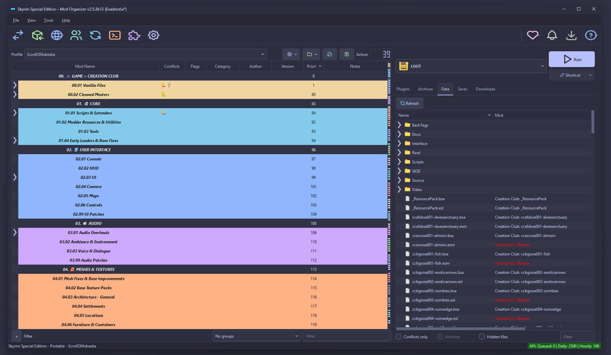

# Adrestia Cozy for Mod Organizer 2



A cozy, modern theme family for [Mod Organizer 2](https://github.com/ModOrganizer2/modorganizer), built around Catppuccin palettes, spacious UI styling, and pastel vector icons.

Adrestia Cozy is designed to remain comfortable during long modding sessions while preserving the information density and status colours that make MO2 useful. **Macchiato** is the first available flavour; additional Catppuccin flavours are planned.

## Features

- Catppuccin-based dark palette with clear visual hierarchy.
- Airier controls, restrained borders, and soft hover and pressed states.
- Alternating list rows without hiding MO2 separator colours.
- Flat tabs, slim scrollbars, and a more prominent **Run** button.
- Pastel vector replacements for the main MO2 actions.
- Explicit styling for disabled, checked, indeterminate, selected, filtered, and invalid states.
- Dark editor, image-browser, application-lock, and FOMOD Plus surfaces independent of the Windows light or dark setting.
- `Fusion` as the MO2 base style for consistent Qt rendering.

## Available flavours

| Flavour | Status |
| --- | --- |
| Catppuccin Macchiato | Available |
| Other Catppuccin flavours | Planned |

## Planned

- Additional Catppuccin flavours using the same visual structure.
- An optional MO2 plugin that styles the native Windows title bar to match the active Adrestia Cozy flavour.

## Compatibility

The current version targets **Mod Organizer 2 2.5.3 beta 12**, **Qt 6**, and **Windows 11**. Other recent MO2 2.5.x versions may work, but have not necessarily received the same visual testing.

The theme only changes Qt widgets and known MO2 action icons. Unknown actions and actions supplied by third-party plugins retain their original icons.

## Installation

1. Download the latest release archive.
2. Close Mod Organizer 2.
3. Extract the archive into the `stylesheets` directory of your MO2 installation.
4. Make sure the QSS file and its matching asset directory remain next to each other:

   ```text
   stylesheets/
   |-- Adrestia Cozy Macchiato.qss
   `-- Adrestia Cozy Macchiato/
       |-- icons/
       `-- toolbar/
   ```

5. Start MO2 and select **Adrestia Cozy Macchiato** under **Settings -> Theme/Style**.
6. Restart MO2 once if every toolbar icon does not refresh immediately.

## Manual installation from the repository

Copy both of these items from `src/` to the MO2 `stylesheets` directory:

```text
Adrestia Cozy Macchiato.qss
Adrestia Cozy Macchiato/
```

The asset directory must keep exactly the same name because the QSS uses relative paths.

## Releases

Stable releases are published from semantic version tags such as `v1.0.0`. Each release provides:

- an `Adrestia-Cozy-X.Y.Z.zip` archive ready to extract into the MO2 `stylesheets` directory;
- automatically generated release notes covering changes since the previous version;
- GitHub's automatically generated source code archives in ZIP and TAR.GZ formats.

## Project layout

```text
.
|-- .github/
|   `-- workflows/
|       `-- release.yml
|-- img/
|   `-- macchiato-screenshot-01.jpg
|-- src/
|   |-- Adrestia Cozy Macchiato.qss
|   `-- Adrestia Cozy Macchiato/
|       |-- icons/
|       `-- toolbar/
|           `-- LICENSE-TABLER.txt
|-- LICENSE
`-- README.md
```

## Credits and third-party licenses

- [Catppuccin Palette](https://github.com/catppuccin/palette) provides the colour palette and is licensed under the MIT License, Copyright (c) 2021 Catppuccin.
- [Catppuccin for Mod Organizer 2](https://github.com/catppuccin/mod-organizer-2) was used as a platform-specific reference and is licensed under GPL-3.0.
- [Tabler Icons](https://github.com/tabler/tabler-icons) provides the toolbar icon geometry. The included icons are based on Tabler Icons 3.46.0 and recoloured for Adrestia Cozy. Tabler Icons is licensed under the MIT License, Copyright (c) 2020-2026 Paweł Kuna. Its complete license notice is included in [`src/Adrestia Cozy Macchiato/toolbar/LICENSE-TABLER.txt`](src/Adrestia%20Cozy%20Macchiato/toolbar/LICENSE-TABLER.txt).
- [Mod Organizer 2](https://github.com/ModOrganizer2/modorganizer) and its bundled [Dracula stylesheet](https://github.com/ModOrganizer2/modorganizer/blob/master/src/stylesheets/dracula.qss) were used as compatibility and widget-coverage references. Mod Organizer 2 is licensed under GPL-3.0.

The small control icons in `src/Adrestia Cozy Macchiato/icons/` were created specifically for this project from simple geometric shapes. No Catppuccin SVG assets or MO2 logos are redistributed.

Adrestia Cozy is an independent community project. It is not an official Catppuccin or Mod Organizer 2 project and is not endorsed by either project.

## License

Adrestia Cozy is distributed under the [GNU General Public License v3.0](LICENSE).

Third-party components remain subject to their respective licenses and copyright notices as listed above.
